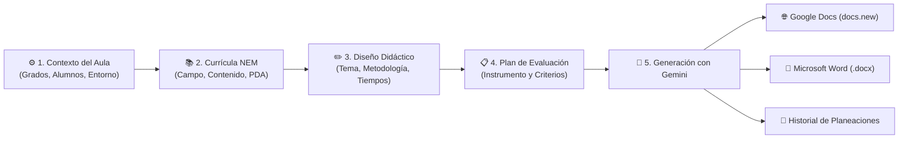

# 🇲🇽 Sistema de Planeación Didáctica NEM — Plan de Estudios 2022

<p align="center">
  
  
  
  
  
  
</p>

<p align="center">
  <strong>Asistente inteligente de planeación didáctica para docentes de Educación Primaria</strong>, alineado con los programas sintéticos de la <strong>Nueva Escuela Mexicana (NEM)</strong> y potenciado por modelos avanzados de <strong>Google Gemini</strong>.
</p>

---

## 🌟 ¿Qué es este sistema?

El **Sistema de Planeación NEM** es una aplicación de escritorio diseñada para maestras y maestros de Educación Primaria en México. Su objetivo es eliminar horas de trabajo administrativo repetitivo al crear secuencias didácticas contextualizadas, rigurosas y apegadas al Plan de Estudios 2022 de la SEP.

A diferencia de los asistentes genéricos de inteligencia artificial, este sistema cuenta con el **catálogo curricular oficial precargado**, comprende a fondo las **4 metodologías sociocríticas oficiales**, adapta cada actividad al **contexto real del aula** (número de alumnos, entorno, estilos VARK y barreras de aprendizaje) y permite exportar directamente tanto a **Google Docs** como a **Microsoft Word**.

---

## ✨ Características Principales

### 📚 1. Catálogo Curricular Oficial Precargado (Fases 3, 4 y 5)
- **Cobertura completa de 1° a 6° de Primaria:** Incluye los Contenidos del Programa Sintético y los **Procesos de Desarrollo de Aprendizaje (PDA)** oficiales para todas las fases:
  - **Fase 3:** 1° y 2° de Primaria.
  - **Fase 4:** 3° y 4° de Primaria.
  - **Fase 5:** 5° y 6° de Primaria.
- **Los 4 Campos Formativos:**
  1. *Lenguajes*
  2. *Saberes y Pensamiento Científico*
  3. *Ética, Naturaleza y Sociedades*
  4. *De lo Humano y lo Comunitario*
- **Filtrado inteligente y automático:** Al seleccionar un campo formativo, la aplicación muestra únicamente los contenidos correspondientes a los grados que el docente atiende.
- **Buscador en tiempo real:** Encuentra contenidos escribiendo palabras clave (ej. *fracciones, ecosistema, leyendas, emociones, democracia*).
- **Selección de PDA con un clic:** Al seleccionar un contenido, sus PDA se despliegan en tarjetas interactivas con casillas de verificación para activar o desactivar los que se trabajarán.
- **Catálogo personal integrado:** Posibilidad de escribir contenidos o PDA locales/comunitarios y guardarlos de forma permanente en el catálogo personal para futuras planeaciones.

---

### 👥 2. Perfil y Contexto del Grupo Permanente (Configúralo una sola vez)
- **Captura única y persistente:** Los datos de tu aula se guardan localmente para que no tengas que escribirlos cada vez que elabores una planeación:
  - Grados atendidos (soporta grupos individuales y multigrado).
  - Número de alumnos en el grupo.
  - Entorno sociocultural (*Urbano, Semiurbano, Rural, Indígena, Migrante*).
  - Estilos de aprendizaje predominantes (**VARK**: *Visual, Auditivo, Lectura/Escritura, Kinestésico*).
  - Barreras para el Aprendizaje y la Participación (**BAP**).
  - Características de convivencia y desarrollo del grupo.
  - Datos escolares (*Docente, Escuela, Ciclo Escolar*).
- **Bienvenida guiada:** Si abres el programa por primera vez sin un contexto guardado, el sistema te dirige automáticamente a la sección de contexto para que configures tu grupo en segundos.
- **Transparencia total:** En la pantalla de generación se muestra un resumen con los alumnos y entorno guardados, con insignias de estado (*✓ Contexto activo* o *⚠️ Contexto incompleto*) y un botón directo para modificarlos en cualquier momento (ej. si ingresan nuevos niños o cambias de ciclo escolar).

---

### 🤖 3. Generación Didáctica Inteligente con Google Gemini
- **Metodologías sociocríticas oficiales:**
  - 🔬 **STEAM:** Ciencia, Tecnología, Ingeniería, Artes y Matemáticas integradas.
  - 🧩 **Aprendizaje Basado en Problemas (ABP):** Resolución de problemáticas reales o hipotéticas del entorno.
  - 🏡 **Proyectos Comunitarios:** Aprendizaje situado que vincula aula, escuela y comunidad.
  - 🤝 **Aprendizaje-Servicio (AS):** Servicio a la comunidad con intencionalidad pedagógica.
- **Evaluación formativa a la medida:**
  - Generación de **Rúbricas descriptivas**, **Listas de Cotejo** o **Guías de Observación**.
  - Criterios de logro adaptados al tema de interés y a los PDA seleccionados.
  - Materiales complementarios (*Ficha de Contenido sintética* y *Formato editable*).
- **Ajustes razonables:** La IA adapta el ritmo, las dinámicas de equipo y las actividades considerando las BAP y los estilos VARK de los estudiantes.

---

### 🌐 4. Exportación sin barreras: Google Docs y Microsoft Word
Pensado para que cualquier docente pueda trabajar sin importar si cuenta o no con una licencia de Microsoft Office:
- **🌐 Abrir en Google Docs (sin licencia de Office):**
  - Con un solo clic, la aplicación procesa la planeación en **HTML enriquecido con estilos institucionales**, la copia al portapapeles de Windows (`CF_HTML`) y abre automáticamente una nueva pestaña en `https://docs.new`.
  - El docente solo debe presionar `Ctrl + V` en Google Docs y la planeación aparece con **tablas con bordes limpios, cabeceras sombreadas, colores institucionales, viñetas y títulos jerárquicos**.
- **📄 Descargar en Word (.docx):**
  - Genera un archivo `.docx` nativo con márgenes profesionales, tablas estilizadas y cabecera institucional listo para guardar o imprimir.
- **📋 Copiar con formato:**
  - Copia la secuencia formateada al portapapeles para pegarla en cualquier procesador de textos o correo electrónico.

---

### 🔐 5. Seguridad y Privacidad Local
- **Cifrado DPAPI de Windows:** Tu API Key de Google Gemini se almacena cifrada mediante las APIs criptográficas nativas del sistema operativo (`CryptProtectData`). Nunca se guarda en texto plano ni se comparte con servidores de terceros.
- **Ejecución 100% local:** La información de tu perfil, historial de planeaciones y catálogo personal se aloja exclusivamente en tu equipo (`%APPDATA%\SistemaPlaneacionNEM`).
- **Gestión automática de procesos:** El backend local en Python es iniciado y detenido de forma transparente por la aplicación de escritorio; no necesitas abrir consolas ni ejecutar scripts en segundo plano.

---

## 🧭 Flujo de Trabajo



---

## 🛠️ Requisitos del Sistema

- **Sistema Operativo:** Windows 10 (versión 1809+) o Windows 11 (64-bit).
- **.NET:** SDK de [.NET 8.0](https://dotnet.microsoft.com/download/dotnet/8.0) para compilar y ejecutar el frontend WPF.
- **Python:** [Python 3.9](https://www.python.org/downloads/) o superior (recomendado 3.10 o 3.11).
- **Conexión a Internet:** Para comunicarse con la API de Google Gemini al generar planeaciones.
- **API Key de Gemini:** Clave gratuita obtenida en [Google AI Studio](https://aistudio.google.com/apikey).

---

## 🚀 Guía de Instalación y Puesta en Marcha

### Paso 1: Clonar el repositorio
Abre una terminal (PowerShell o CMD) y clona el proyecto:
```bash
git clone https://github.com/tu-usuario/SistemaPlaneacionNEM.git
cd SistemaPlaneacionNEM
```

---

### Paso 2: Configurar el entorno de Python (Backend)
Crea y activa el entorno virtual en la carpeta `backend`, e instala las dependencias requeridas:

```powershell
# Ingresa a la carpeta backend
cd backend

# Crea el entorno virtual
python -m venv venv

# Activa el entorno virtual en PowerShell
.\venv\Scripts\Activate.ps1
# (En caso de usar CMD estándar: .\venv\Scripts\activate.bat)

# Instala las dependencias oficiales
pip install -r requirements.txt

# Regresa a la raíz del repositorio
cd ..
```

> [!NOTE]
> La aplicación de WPF busca automáticamente el intérprete de Python en `backend\venv\Scripts\python.exe`. Al configurar el entorno virtual en esa ubicación, el frontend lo iniciará y gestionará de manera completamente autónoma.

---

### Paso 3: Compilar y ejecutar la aplicación WPF (Frontend)
Desde la terminal, dirígete a la carpeta `Frontend` y ejecuta el proyecto:

```powershell
cd Frontend
dotnet build
dotnet run
```

*(También puedes abrir la solución `SistemaPlaneacionNEM.sln` directamente en **Visual Studio 2022** y presionar **F5**).*

---

### Paso 4: Configuración inicial en la aplicación
1. **Configurar el Contexto del Grupo:**
   - La primera vez que abras el sistema, serás dirigido automáticamente a la sección **⚙️ Configuración → Perfil del Grupo (Contexto)**.
   - Selecciona los grados que atiendes (ej. *3° Primaria*), escribe el número total de alumnos, selecciona el entorno sociocultural (*Urbano, Rural*, etc.) y guarda el perfil.
2. **Agregar tu API Key de Gemini:**
   - En la pestaña **🔑 API Key y Modelo Gemini**, pega tu clave obtenida gratis en [Google AI Studio](https://aistudio.google.com/apikey).
   - Haz clic en **Guardar API Key**. El sistema verificará la conexión de inmediato y la cifrará con seguridad en tu equipo.

¡Listo! Ya puedes ir a **📝 Asistente de Planeación** y crear tu primera planeación didáctica.

---

## 📁 Estructura del Repositorio

```text
SistemaPlaneacionNEM/
├── backend/                             # API local en FastAPI y servicios de IA
│   ├── catalogo/                        # Catálogo curricular oficial en formato JSON
│   │   ├── fase3.json                   # 1° y 2° de Primaria (los 4 Campos Formativos)
│   │   ├── fase4.json                   # 3° y 4° de Primaria (los 4 Campos Formativos)
│   │   └── fase5.json                   # 5° y 6° de Primaria (los 4 Campos Formativos)
│   ├── almacenamiento.py                # Persistencia local (perfil, historial y datos)
│   ├── catalogo.py                      # Servicio de filtrado y fusión de catálogo base y personal
│   ├── exportar_docx.py                 # Generador estructurado de documentos Word (.docx)
│   ├── main.py                          # Servidor FastAPI y endpoints REST locales
│   ├── models.py                        # Modelos de datos Pydantic para validación
│   ├── requirements.txt                 # Dependencias de Python (FastAPI, google-genai, etc.)
│   ├── seguridad.py                     # Cifrado DPAPI para protección de la API Key
│   └── servicio_ia.py                   # Lógica de prompts y comunicación con Google Gemini
│
├── Frontend/                            # Aplicación de escritorio moderna en C# .NET 8 WPF
│   ├── Converters/                      # Conversores de datos XAML (Visibilidad, Estados, etc.)
│   ├── Models/                          # DTOs tipados que reflejan los contratos del backend
│   ├── Services/                        # Clientes HTTP, integración con portapapeles y procesos
│   │   ├── ApiClient.cs                 # Cliente HTTP fuertemente tipado para la API local
│   │   ├── BackendManager.cs            # Supervisor del proceso de fondo de Python
│   │   ├── BorradorService.cs           # Almacenamiento local de borradores en curso
│   │   └── ExportadorGoogleDocs.cs      # Conversor Markdown a HTML enriquecido para Google Docs
│   ├── ViewModels/                      # Patrón MVVM desacoplado y reactivo
│   │   ├── Comandos.cs                  # Implementaciones de ICommand (RelayCommand, AsyncRelayCommand)
│   │   ├── ConfiguracionViewModel.cs    # Lógica de configuración de perfil y API Key
│   │   ├── MainViewModel.cs             # Orquestador del Asistente (Wizard) y exportación
│   │   ├── Opciones.cs                  # Colecciones observables para Chips, listas y PDA
│   │   └── ViewModelBase.cs             # Base con INotifyPropertyChanged y SetProperty
│   ├── Views/                           # Vistas de usuario en XAML
│   │   ├── ConfiguracionView.xaml       # Vista de perfil de grupo y credenciales
│   │   └── HistorialView.xaml           # Vista de consulta y descarga de planeaciones previas
│   ├── App.xaml                         # Paleta de colores NEM, temas y estilos visuales globales
│   ├── MainWindow.xaml                  # Ventana principal y Stepper interactivo de 4 pasos
│   └── Frontend.csproj                  # Archivo de configuración del proyecto .NET 8
│
└── README.md                            # Documentación principal del proyecto
```

---

## 🎨 Paleta de Diseño Institucional

La interfaz visual fue diseñada siguiendo una paleta cálida y moderna inspirada en los libros de texto y materiales oficiales de la Nueva Escuela Mexicana:

| Muestra | Nombre del Color | Código Hex | Uso principal |
|:---:|:---|:---:|:---|
| 🧱 | **Terracota NEM** | `#C25A38` | Botones de acción principal, acentos y pasos activos |
| 🌿 | **Verde Salvia** | `#4E7D6E` | Badges de éxito, campos formativos y pasos completados |
| 📜 | **Marfil Suave** | `#FDF8F2` | Fondo principal relajante para lectura prolongada |
| 🍞 | **Arena Suave** | `#FAF7F2` | Fondos de tarjetas, listados y contenedores |
| 🪨 | **Pizarra Oscura** | `#1E293B` | Tipografía principal con alto contraste y legibilidad |
| 🌐 | **Azul Google** | `#1A73E8` | Botones de exportación directa a Google Docs |

---

## ❓ Preguntas Frecuentes (FAQ)

<details>
<summary><strong>1. ¿Tiene algún costo utilizar la API Key de Google Gemini?</strong></summary>
<br/>
No. Google AI Studio ofrece un nivel gratuito muy generoso para desarrolladores y educadores con modelos rápidos como Gemini 2.5 Flash o Gemini 1.5 Flash, más que suficiente para generar decenas de planeaciones didácticas diarias sin costo alguno.
</details>

<details>
<summary><strong>2. ¿Qué pasa si no tengo Microsoft Office instalado en mi computadora?</strong></summary>
<br/>
¡No hay ningún problema! Puedes utilizar el botón <strong>«Abrir en Google Docs»</strong>. El sistema copiará automáticamente la planeación con formato completo (tablas con bordes y encabezados sombreados, colores, viñetas y títulos) y abrirá una pestaña nueva en tu navegador. Solo deberás presionar <code>Ctrl + V</code> para tener tu documento listo para imprimir o editar desde la nube de Google.
</details>

<details>
<summary><strong>3. ¿Funciona para escuelas multigrado o docentes con más de un grado?</strong></summary>
<br/>
Sí. En la sección de configuración de tu grupo puedes marcar varios grados a la vez (ejemplo: <em>1° y 2° Primaria</em> o <em>4°, 5° y 6° Primaria</em>). El catálogo filtrará de forma automática los contenidos de las fases involucradas y la planeación integrará los PDA pertinentes.
</details>

<details>
<summary><strong>4. ¿Dónde se guardan mis datos y planeaciones?</strong></summary>
<br/>
Todos tus datos permanecen en tu computadora. Se guardan en tu carpeta de perfil de usuario en Windows: <code>%APPDATA%\SistemaPlaneacionNEM</code>. Ni tus alumnos, ni tus planeaciones, ni tu clave de API se transmiten a ningún servidor externo que no sea la API de Google Gemini para la generación solicitada.
</details>

---

## 📄 Licencia

Este proyecto está bajo la licencia **MIT**. Eres libre de usarlo, estudiarlo, modificarlo y compartirlo con tu comunidad docente.

---

<p align="center">
  Hecho con ❤️ para las maestras y los maestros de México 🇲🇽
</p>